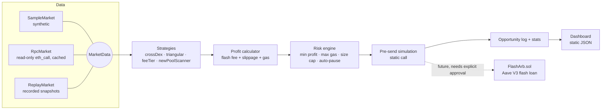
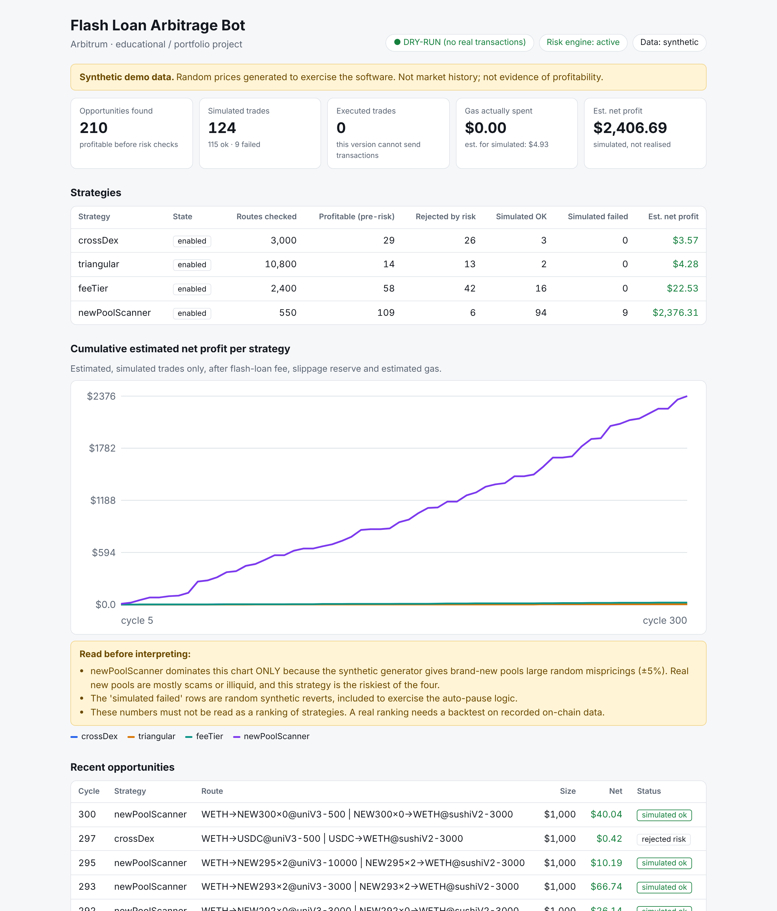

# Flash Loan Arbitrage on Arbitrum

An educational, portfolio-grade implementation of a flash-loan arbitrage system: a Solidity contract that borrows from
Aave V3 and reverts unless the trade is profitable, plus a TypeScript plug-in bot that finds, prices, risk-checks and
**simulates** opportunities, a backtesting pipeline, and a static dashboard.

> **Disclaimer.** Educational / portfolio project. Not financial advice. No profit guarantees. **Not security-audited.**
> Use at your own risk. This repository contains no claim of real profits: every number shown comes from unit tests or
> from clearly labelled **synthetic** demo data.

## Current status (honest)

| Area | State |
|---|---|
| Smart contract + 17 Foundry logic tests (mocks) | Done, passing |
| Foundry fork tests against real Arbitrum (Aave + Uniswap) | Written, **not yet run** (needs an RPC URL) |
| Bot framework, 4 strategies, risk engine, 33 unit tests | Done, passing; dry-run only |
| Live RPC market data, static-call simulator, historical collector | Written, **not yet exercised on a live network** |
| Backtest engine + report generator | Done, tested on synthetic data |
| **Real backtest / dry-run results** | **None yet.** See "Results" |
| Testnet end-to-end test | Instructions in [docs/TESTNET.md](docs/TESTNET.md), **not yet run** |
| Dashboard | Done; shows **synthetic** demo data |

## Architecture

The bot has **no code path that sends a transaction**; `DRY_RUN=false` is refused and `PRIVATE_KEY` is never read.

## The contract (`contracts/src/FlashArb.sol`)
Borrows one token via Aave V3 `flashLoanSimple`, runs a route of swaps (Uniswap V3 `exactInputSingle` or a Uniswap-V2-style
router such as SushiSwap), repays loan + premium, and **reverts the whole transaction** if net profit < `minProfit`.
Safety: owner-only `execute`/`withdraw`/`pause`/`setRouterAllowed`; callback accepts only the Aave pool and only when the
contract itself started the loan; router allow-list; pause switch; reentrancy guard. On-chain `minProfit` does not include
gas (gas is paid by the sending wallet); the bot accounts for it off-chain.

## The strategies (`bot/src/strategies/`)
Each strategy is a separate module implementing one `Strategy` interface and is switched on/off in `bot/strategies.config.json`.

| Strategy | Idea | Realistic outlook |
|---|---|---|
| `crossDex` | Sell on one DEX, buy back on another | Spreads are usually smaller than fees, and are taken within a block by faster bots |
| `triangular` | A→B→C→A across venues | Same competition; more hops mean more fees and gas |
| `feeTier` | Same pair, different Uniswap V3 fee tiers | Tiny, short-lived gaps; heavily competed |
| `newPoolScanner` | Mispriced brand-new pools, with safety filters (liquidity, age, honeypot/sell check, tax) | **Highest risk**: new tokens are frequently scams; discovery of new pools is **not implemented** yet |

Shared components: price monitor (`core/market`), profit calculator, risk engine, simulator, opportunity store.

## Tech stack
Solidity 0.8.26 · Foundry · OpenZeppelin 5 · TypeScript (Node 22) · ethers v6 · Vitest · static HTML/CSS/JS dashboard ·
gitleaks pre-commit secret scanning · GitHub Actions CI. Everything runs on free tiers (free RPC, Vercel free, local fork).

## Setup
Windows users: install WSL2 (Ubuntu), then work inside Ubuntu.

    git clone <this repo> && cd <repo>
    bash scripts/install-hooks.sh                 # enables the gitleaks pre-commit hook (install gitleaks first)
    cp .env.example .env                          # fill in YOUR values; .env is git-ignored. Use a burner wallet only.

    # contracts
    cd contracts
    bash ../scripts/install-contract-deps.sh
    forge test --no-match-contract Fork           # logic tests with mocks, no network
    export ARBITRUM_RPC_URL=<free RPC URL>
    forge test --match-contract Fork -vv          # fork tests (verify the addresses at the top of that file first)

    # bot
    cd ../bot && npm install
    npm test && npm run typecheck
    npm run dry-run -- --cycles 200 --seed 42     # synthetic data, dry-run
    npm run dry-run -- --source rpc               # live read-only data from your RPC (still dry-run)

    # dashboard
    cd ../dashboard && npx serve .

### Free-tier notes
Free RPC plans rate-limit requests. The bot caches per cycle, throttles calls (`minCallIntervalMs`) and polls at
`POLL_INTERVAL_MS`; scanning many routes will be slow on a free plan. Historical backtests need an archive-capable RPC
(limited history on free plans) or a local `anvil --fork-url` fork.

## Dry-run, backtesting and results
- Live dry-run logs every opportunity with its estimated net profit to `bot/data/*.local.jsonl`.
- `npm run collect` records real historical quotes; `npm run backtest` replays them through the same engine and writes a report.
- **Results: none yet.** No backtest on real data has been run. When it is, the report generated by `npm run backtest` will be
  pasted here unedited. The synthetic report only proves the pipeline works.

## Screenshots (synthetic demo data)
| Desktop | Mobile |
|---|---|
|  |  |

The dashboard displays randomly generated prices and says so in a banner. In those demo data `newPoolScanner` "wins" only
because the generator gives new pools large random mispricings; that is **not** a finding.

## Limitations and risks
- **Competition.** Flash-loan arbitrage on Arbitrum is contested by professional bots with low-latency infrastructure.
  Arbitrum has a first-come-first-served sequencer and no public mempool, so the usual MEV tricks do not apply; with a free RPC and
  a laptop or free VM, finding opportunities that survive fees and gas is unlikely. Treat profitability as unproven.
- **Backtests are an upper bound**: opportunities are assumed to fill at the recorded quote; competing bots, latency and price
  movement before inclusion are not modelled. Snapshot sampling can miss or double-count short-lived gaps.
- **Gas is estimated** from config values (Arbitrum also charges an L1 data fee). Addresses in `strategies.config.json` and the fork
  tests were written from memory and must be verified against official sources (Aave address book, Uniswap docs, Arbiscan).
- **Smart-contract risk.** The contract is unaudited. Bugs, approvals, router behaviour or token quirks (fee-on-transfer, honeypots) can lose funds.
- **Untested paths.** Live RPC, collector, static-call simulator, fork tests and testnet deployment have not been run by the author.
- **Not implemented:** live execution, new-pool discovery from chain events, MEV protection.

## How I built it
This project was built with AI-assisted development (Claude Code), step by step, with a human reviewing and approving each phase.
The tests and the security scanning described above are what back its claims; the code has not had an independent review or audit.

## License
MIT, see [LICENSE](LICENSE). Final pre-publish checks: [docs/SECURITY_CHECKLIST.md](docs/SECURITY_CHECKLIST.md).
