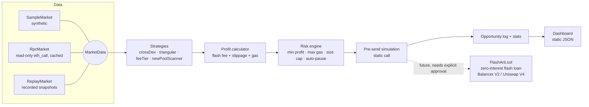
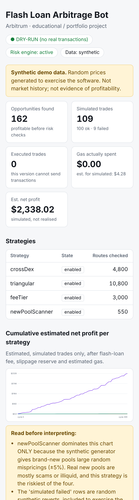

# Flash Loan Arbitrage on Arbitrum

An educational, portfolio-grade implementation of a flash-loan arbitrage system: a Solidity contract that borrows with
**zero-interest flash loans** (Balancer V2 Vault or Uniswap V4 PoolManager) and reverts unless the trade is profitable, plus a TypeScript plug-in bot that finds, prices, risk-checks and
**simulates** opportunities, a backtesting pipeline, and a static dashboard.

> **Disclaimer.** Educational / portfolio project. Not financial advice. No profit guarantees. **Not security-audited.**
> Use at your own risk. This repository contains no claim of real profits: every number shown comes from unit tests or
> from clearly labelled **synthetic** demo data.

## Current status (honest)

| Area | State |
|---|---|
| Smart contract (zero-interest loans only: Balancer V2 + Uniswap V4) + 29 Foundry logic tests (mocks) | Done, passing |
| Foundry fork tests against real Arbitrum One | **4/4 passing** on a live RPC: Balancer V2 and Uniswap V4 lenders (earlier Aave+Balancer version: 5/5) |
| On-chain identity check of all contract addresses (`scripts/verify-addresses.sh`) | **13/13 passing** on Arbitrum One |
| Bot framework, 4 strategies, risk engine, 33 unit tests | Done, passing (also on a clean machine); dry-run only |
| Historical collector + RPC price quotes | **Run on real data**: 48 snapshots of Arbitrum One (about 24 h) |
| Backtest engine + report generator | **Run on real data**; see "Results" |
| Live dry-run loop with RPC data, static-call simulator | Written, **not yet run** |
| Testnet end-to-end test | Instructions in [docs/TESTNET.md](docs/TESTNET.md), **not yet run** |
| Dashboard | Done; shows **synthetic** demo data |

### What the fork tests showed (real Arbitrum state, earlier version with both Aave V3 and Balancer V2)
Aave was later removed so that the contract only uses zero-interest loans; these measurements explain that decision.
- **Unprofitable round trip is rejected.** Borrow 10 WETH from Aave, sell on the Uniswap V3 0.05% pool, buy back on the
  0.30% pool: the route returned **9.923 WETH** against **10.005 WETH** owed (loan + 5 bps Aave premium), so the contract
  reverted with `InsufficientProfit`. A plain round trip loses about 0.8% to fees and price impact.
- **Profitable path works end to end.** After the test itself pushes one pool's price with a large swap (an
  **artificial** spread created inside the test), the contract borrows, swaps, repays and keeps the profit.
  This proves the mechanics, not that such spreads exist in the market.
- **Second zero-interest lender confirmed (Uniswap V4).** Borrowing 1 WETH through the PoolManager's flash accounting,
  the same artificial-spread trade kept 0.882 WETH (Balancer: 8.731 WETH on a 10 WETH loan, the same ~0.87-0.88 per WETH),
  and the unprofitable trade reverted with `InsufficientProfit`. On-chain on 2026-11-24 the PoolManager held ~27.8 WETH
  and ~9.04M USDC, so it is also the lender that makes USDC borrowing possible (Balancer held only ~4.7k USDC).
- **Zero-fee lender confirmed.** The same artificial-spread trade funded by Balancer kept 8.744061 WETH versus 8.739061 WETH
  via Aave: exactly 0.005 WETH more, the 5 bps Aave premium on 10 WETH.
- Running on a real fork surfaced and fixed four issues the sandboxed build could not see (EVM version, a forge-std import,
  dependency installation, and an over-strict revert assertion).

## Architecture

The bot has **no code path that sends a transaction**; `DRY_RUN=false` is refused and `PRIVATE_KEY` is never read.

## The contract (`contracts/src/FlashArb.sol`)
Borrows one token with a **zero-interest flash loan**, runs a route of swaps (Uniswap V3 `exactInputSingle` and its
forks such as PancakeSwap V3, or a Uniswap-V2-style router such as SushiSwap), repays the loan, and **reverts the whole
transaction** unless the trade itself made at least `minProfit`.

Two zero-interest lenders, chosen per trade (`execute(lender, ...)`):
- **Balancer V2 Vault** (`flashLoan`): fee 0 on Arbitrum when checked on-chain (2026-11-24); ~110 WETH, ~4.2k USDC then.
- **Uniswap V4 PoolManager** (flash accounting: `unlock` -> `take` -> trade -> `sync`/`settle`): no fee by design; the
  PoolManager reverts the whole `unlock` if the debt is not settled.
- If a lender ever charges a fee, the contract repays it and the profit check includes it, so a fee change cannot cause a
  silent loss. Which tokens each lender can supply is set in `flashLoan.lenders` (`bot/strategies.config.json`) and
  checked on-chain by `scripts/verify-addresses.sh`, which prints each lender's current WETH/USDC balance.
- Aave V3 was supported in an earlier version (5 bps premium) and removed by design; it is still in the git history.

Safety: owner-only `execute`/`withdraw`/`pause`/`setRouterAllowed`; each callback accepts only its lender and only the
exact loan the contract just requested (Balancer does not report the initiator, so foreign loans naming this contract are
rejected); router allow-list; pause switch; reentrancy guard. Profit is measured against the balance **before** the loan,
so old un-withdrawn profits can never hide a losing trade (a bug found and fixed during development, with regression
tests). On-chain `minProfit` does not include gas (paid by the sending wallet); the bot accounts for it off-chain.

## The strategies (`bot/src/strategies/`)
Each strategy is a separate module implementing one `Strategy` interface and is switched on/off in `bot/strategies.config.json`.

| Strategy | Idea | Realistic outlook |
|---|---|---|
| `crossDex` | Sell on one DEX, buy back on another | Spreads are usually smaller than fees, and are taken within a block by faster bots |
| `triangular` | A→B→C→A across venues | Same competition; more hops mean more fees and gas |
| `feeTier` | Same pair, different Uniswap V3 fee tiers | Tiny, short-lived gaps; heavily competed |
| `newPoolScanner` | Mispriced brand-new pools, with safety filters (liquidity, age, honeypot/sell check, tax) | **Highest risk**: new tokens are frequently scams; discovery of new pools is **not implemented** yet |

Shared components: price monitor (`core/market`), profit calculator, risk engine, simulator, opportunity store.

## Tech stack
Solidity 0.8.26 · Foundry · OpenZeppelin 5 · TypeScript (Node 22) · ethers v6 · Vitest · static HTML/CSS/JS dashboard ·
gitleaks pre-commit secret scanning · GitHub Actions CI. Everything runs on free tiers (free RPC, Vercel free, local fork).

## Setup
Windows users: install WSL2 (Ubuntu), then work inside Ubuntu.

    git clone <this repo> && cd <repo>
    bash scripts/install-hooks.sh                 # enables the gitleaks pre-commit hook (install gitleaks first)
    cp .env.example .env                          # fill in YOUR values; .env is git-ignored. Use a burner wallet only.

    # contracts
    cd contracts
    bash ../scripts/install-contract-deps.sh
    forge test --no-match-contract Fork           # logic tests with mocks, no network
    export ARBITRUM_RPC_URL=<free RPC URL>
    forge test --match-contract Fork -vv          # fork tests (verify the addresses at the top of that file first)

    # bot
    cd ../bot && npm install
    npm test && npm run typecheck
    npm run dry-run -- --cycles 200 --seed 42     # synthetic data, dry-run
    npm run dry-run -- --source rpc               # live read-only data from your RPC (still dry-run)

    # dashboard
    cd ../dashboard && npx serve .

### Free-tier notes
Free RPC plans rate-limit requests. The bot caches per cycle, throttles calls (`minCallIntervalMs`) and polls at
`POLL_INTERVAL_MS`; scanning many routes will be slow on a free plan. Historical backtests need an archive-capable RPC
(limited history on free plans) or a local `anvil --fork-url` fork.

## Dry-run, backtesting and results
- Live dry-run logs every opportunity with its estimated net profit to `bot/data/*.local.jsonl`.
- `npm run collect` records real historical quotes; `npm run backtest` replays them through the same engine and writes a report.

### Results: 24 hours of real Arbitrum One data (2026-11-24)
48 snapshots (blocks 526627702–526966102, one every ~30 min), 26 real price curves each. Full report, unedited:
[docs/reports/backtest-2026-11-24-arbitrum-24h.md](docs/reports/backtest-2026-11-24-arbitrum-24h.md).

| Strategy | Routes evaluated | Profitable before risk | Passed risk | Closest to break-even (USD) |
|---|---:|---:|---:|---:|
| crossDex | 768 | 0 | 0 | -63.97 |
| triangular | 1728 | 0 | 0 | -15.69 |
| feeTier | 480 | 0 | 0 | -2.51 |
| newPoolScanner | 0 (not backtestable with this data) | 0 | 0 | - |

Re-run on the same data with a **zero-fee lender** (Balancer V2): closest to break-even became -63.47 / -15.19 / **-2.01**,
exactly $0.50 better each (the 5 bps Aave premium on a $1,000 trade). Still no profitable route.

### Results: one hour of block-level gap monitoring (2026-11-24)
12,680 Arbitrum blocks, 6,893 polls (one Multicall3 call each), 0 errors. Deep pools never left their fee band; the gaps
that did were in thin SushiSwap pools where every quote, even at $100, lost money after price impact (best: -$0.77).
Full report: [docs/reports/gap-monitor-2026-11-24-1h.md](docs/reports/gap-monitor-2026-11-24-1h.md).

### Results: expanded radar, one more hour (2026-11-24)
91 pools discovered (29 alive above $50k TVL; PancakeSwap V3 and the Uniswap 0.01% tier added), 32 pool pairs, 12,299
blocks, 0 errors. Best estimated nets were between **-$0.12 and -$0.47** (vs -$2.09 before). WETH/USDC between the
Uniswap and PancakeSwap 0.01% pools sat outside its fee band 64% of the time (50 episodes, median ~23 s), still slightly
negative after a 10 bps safety reserve. Report: [docs/reports/gap-monitor-2026-11-24-1h-expanded.md](docs/reports/gap-monitor-2026-11-24-1h-expanded.md).

### Results: same radar, net before the safety reserve (2026-11-24)
Even with the 10 bps slippage reserve removed, no episode was positive: best -$0.02 (WBTC/WETH), and the best trade size
was always the smallest ($100), because larger trades lose more to price impact. The remaining gaps are worth a few cents,
about the cost of gas. Report: [docs/reports/gap-monitor-2026-11-24-1h-before-reserve.md](docs/reports/gap-monitor-2026-11-24-1h-before-reserve.md).

### Results: Aave V3 liquidations on Arbitrum, 3 days of real data (2026-11-21 to 25)
Read-only measurement for a possible liquidation module: 14 liquidations in the whole market, about **$122 per day of gross
bonus for all liquidators together** (before any cost), 99% of it in the 3 largest. Every liquidation with a bonus of $1 or
more was taken within 2 blocks (100% of the prize by value); the only slow ones were dust positions (median bonus $0.01).
Verdict: crowded; a liquidation bot here is a portfolio project, not a profit source. Report:
[docs/reports/liquidations-2026-11-21-to-25-arbitrum.md](docs/reports/liquidations-2026-11-21-to-25-arbitrum.md).

**No profitable opportunity was found.** Every route lost money after the flash-loan premium, DEX fees, price impact,
slippage reserve and gas. `feeTier` came closest. This is the expected result for liquid pools that professional bots keep
in line, and it is the reason this project stays in dry-run mode. Sampling every 30 minutes cannot see gaps that last seconds.

## Screenshots (synthetic demo data)
| Desktop | Mobile |
|---|---|
|  |  |

The dashboard displays randomly generated prices and says so in a banner. In those demo data `newPoolScanner` "wins" only
because the generator gives new pools large random mispricings; that is **not** a finding.

## Limitations and risks
- **Competition.** Flash-loan arbitrage on Arbitrum is contested by professional bots with low-latency infrastructure.
  Arbitrum has a first-come-first-served sequencer and no public mempool, so the usual MEV tricks do not apply; with a free RPC and
  a laptop or free VM, finding opportunities that survive fees and gas is unlikely. Treat profitability as unproven.
- **Backtests are an upper bound**: opportunities are assumed to fill at the recorded quote; competing bots, latency and price
  movement before inclusion are not modelled. Snapshot sampling can miss or double-count short-lived gaps.
- **Gas is estimated** from config values (Arbitrum also charges an L1 data fee).
- **Addresses** were written from memory, then checked on-chain with `scripts/verify-addresses.sh` (token symbols and decimals,
  routers pointing to the canonical Uniswap factory and WETH, Balancer Vault live and unpaused, Multicall3 present). That is an
  identity check, not a substitute for the official sources (Balancer, Uniswap and Sushi docs, Arbiscan).
- **Smart-contract risk.** The contract is unaudited. Bugs, approvals, router behaviour or token quirks (fee-on-transfer, honeypots) can lose funds.
- **Untested paths.** The bot's live dry-run loop over RPC, the static-call simulator and testnet deployment have not been run yet.
- **Dependencies.** `npm audit --omit=dev` reports 0 vulnerabilities in the bot's runtime dependencies (checked 2026-11-24).
  The advisories `npm audit` shows without that flag are in development tooling only (test runner/bundler).
- **Not implemented:** live execution, new-pool discovery from chain events, MEV protection.

## How I built it
This project was built with AI-assisted development (Claude Code), step by step, with a human reviewing and approving each phase.
The tests and the security scanning described above are what back its claims; the code has not had an independent review or audit.

## License
MIT, see [LICENSE](LICENSE). Final pre-publish checks: [docs/SECURITY_CHECKLIST.md](docs/SECURITY_CHECKLIST.md).
